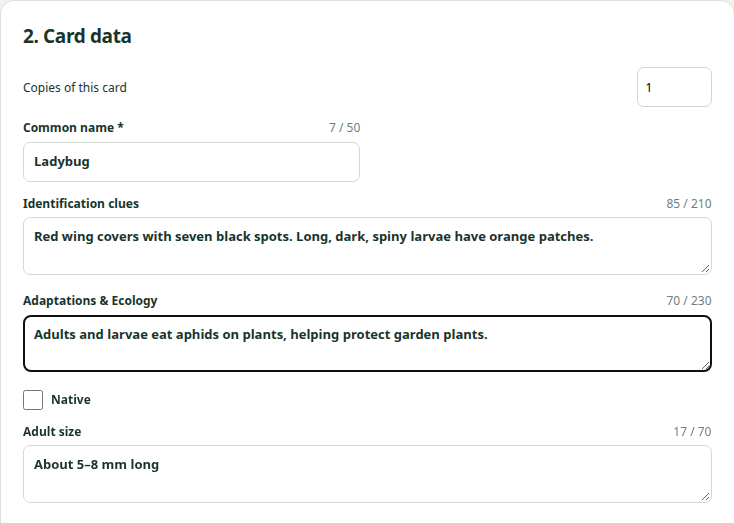
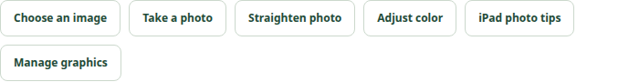
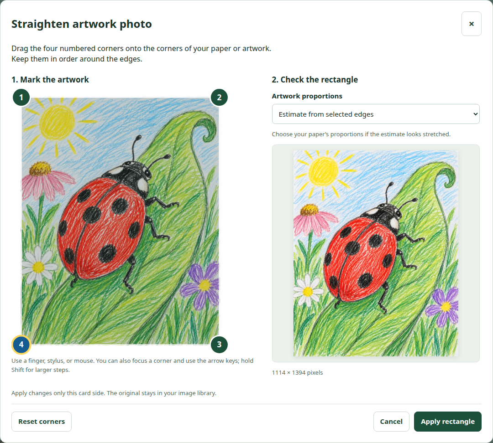
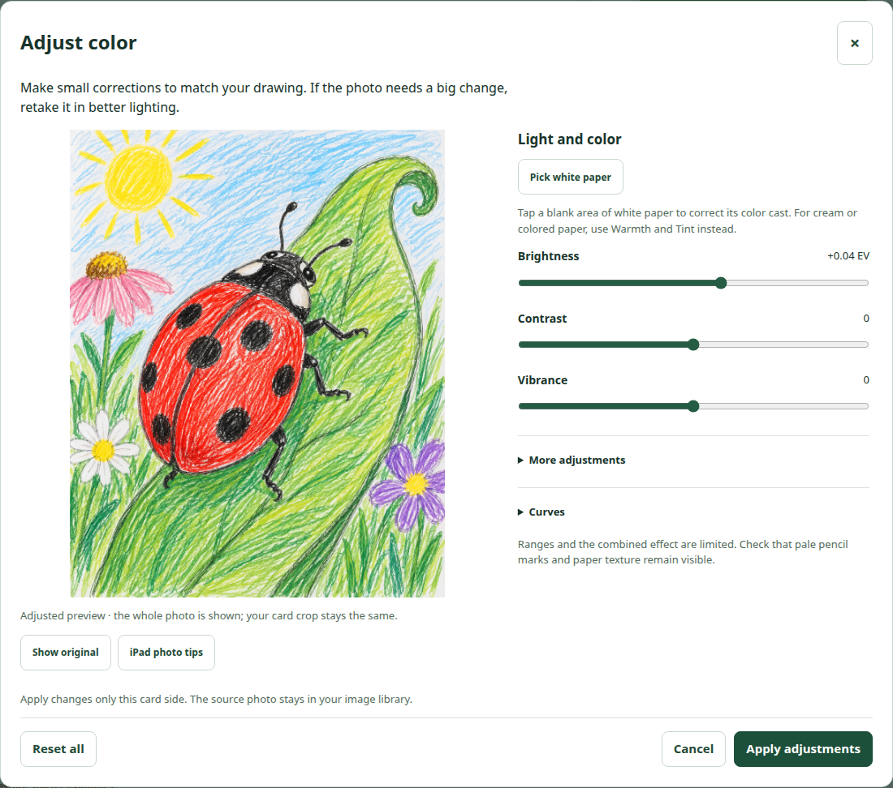
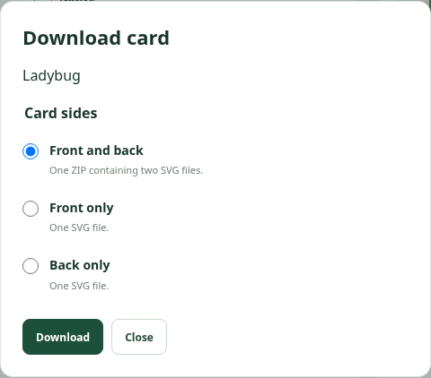
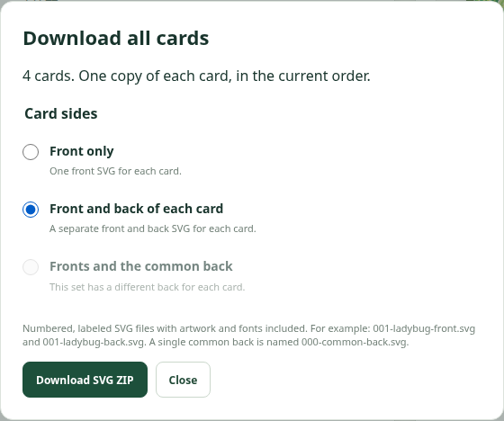

# DOWNLOAD YOUR WORK TO KEEP IT

**YOUR WORK MAY NOT SAVE UNLESS YOU DOWNLOAD IT. Do not rely on this browser to remember your cards. Before you leave, choose Save project and check that the ZIP file has downloaded.**

**Download again after making changes.** Switching iPads, clearing browser data, or using a private tab can leave you without your work. A link to this page is not a backup.

## 1. Write a small, useful field guide

Your card is only **2.5 × 3.5 inches**. Help someone recognize your organism and understand how it lives. Choose **Front** for its names, group, and main drawing; choose **Back** for notes and a second identification drawing.

| Field | What to write | Space to aim for |
| --- | --- | --- |
| Common name | The organism's usual name. | One short line; up to 40 characters on the front. |
| Genus and species | The scientific name, spelled carefully. Capitalize the genus; use lowercase for the species. | Genus + species; up to 52 characters. |
| family | Its scientific family name. | Just the name; it shares the scientific-name line. |
| Group | A useful group, such as insect, lizard, or wildflower. | A short phrase; up to 44 characters. |
| Adult size | A typical adult length or plant height, with units. Say whether a tail is included. | A phrase such as “5–8 mm long”; up to 70 characters. |
| Identification clues | Two or three visible details that separate it from similar organisms. | About 20–30 words; five lines, up to 210 characters. |
| Adaptations & Ecology | Where it lives, what it eats or its ecosystem role, and how a feature helps it survive. | About 25–35 words; five lines, up to 230 characters. |

**Character counts include spaces and punctuation. These are limits, not targets.** Long words may fill a line sooner. Check both card previews and shorten text if it overflows or becomes hard to read.

Only check **Native** if you have verified that the species is native to our Texas region. Seeing it nearby does not prove that it is native.

## 2. Find facts, then cut extra words

1. **Confirm the organism.** Match its scientific name and several features to your observation. Compare similar species. Ask your teacher if the identification is uncertain.
2. **Find a dependable source.** Try a museum, university or extension service, government nature page, or a field guide. Search the scientific name with “identification,” “size,” “habitat,” or “diet.” Read the page, not just a search snippet.
3. **Keep a few useful facts.** Write notes in your own words. Keep the source title and link in your research notes for your teacher; long URLs use up card space.
4. **Choose distinguishing details.** Look for leaf arrangement, flower shape, body markings, number of parts, or a distinctive body shape. “Green plant” is less useful than “leaves in whorls of four to six.” Choose details someone could check in your drawing or in the field.
5. **Cut introductions and repetition.** Delete “This organism is,” “It is interesting that,” “very,” and repeated names. Use specific nouns and verbs. Short phrases and semicolons are fine if the meaning stays clear.

**Identification example — field madder:** “Low, spreading plant; pointed leaves in whorls of four to six; tiny pink-lilac flowers with four lobes.”

**Ecology example:** “An introduced annual of lawns and disturbed ground. Spreading stems form low patches among grass; its life cycle finishes within one year.”

Keep visible identification details in **Identification clues**. Use **Adaptations & Ecology** to explain habitat, food, or how a feature helps. Do not invent a sighting, diet, or adaptation to fill the box.

## 3. Photograph your artwork with an iPad

1. **Select the correct card and Front or Back first.** A photo replaces the artwork on the selected side.
2. Flatten your drawing. Clean the rear camera lens. Find bright, even light, away from direct sun, glare, and shadows from your hands or iPad.
3. Tap **Take a photo**. Hold the iPad parallel to the paper, with its camera over the middle. Include **all four corners** and a small margin; move closer instead of zooming.
4. Tap the drawing to focus and hold still. Check that pale pencil lines remain visible. Retake a blurry, shadowy, or washed-out photo; editing cannot restore missing detail.
5. Accept the photo. If it is already in Photos, use **Choose an image** and select one picture instead. **iPad photo tips** gives extra help.

## 4. Straighten the paper

The straightening window opens after a camera photo. For an existing image, tap **Straighten photo**.

1. Drag the **four numbered corners** onto the corners of your paper or rectangular artwork. Keep them in order around its edges; do not cross them.
2. Check the corrected rectangle. If it looks stretched, choose the matching **Artwork proportions**, such as **Letter paper · 8.5:11**. Match the paper you photographed, not the card shape.
3. Tap **Apply rectangle**. Use **Cancel** to keep the original instead, or **Undo straighten** immediately afterward if needed.
4. Open **Adjust or switch your image**. Use **Zoom**, **Horizontal position**, and **Vertical position** to fit the drawing inside the card without cutting off identifying details.

## 5. Make small color corrections

Tap **Adjust color**. Aim to match the real drawing, rather than making the colors stronger.

1. If the paper is white, choose **Pick white paper**, then tap a blank, uncolored area in the preview. Do not sample a pencil mark, shadow, or colored paper.
2. Adjust **Brightness** a little if needed. Use a small amount of **Contrast** for clarity and **Vibrance** only if colors look dull.
3. Under **More adjustments**, **Paper brightness** can lighten the background. Keep faint lines and light shading visible. For cream or colored paper, use **Warmth** and **Tint** instead of Pick white paper. Leave **Curves** alone unless you need them.
4. Use **Show original** to compare. If the photo needs a large correction, retake it in better light.
5. Tap **Apply adjustments**, or **Cancel**. Use **Undo photo adjustment** immediately afterward if you need to go back.

Repeat the photo steps on the other side if it needs different artwork. Check **Front** and **Back** before downloading.

## 6. Download one card or several cards

**One card:** Select it, tap **Download card**, leave **Front and back** selected, then tap **Download**. You get one ZIP with a front SVG and a back SVG. Choose **Front only** or **Back only** if your teacher needs just one side.

**Several cards:** Tap **Download all cards**, choose **Front and back of each card**, then **Download SVG ZIP**. This includes every card in the current workspace, once each, in the current order. It does not download just a selected few. Use **Front only** if your teacher asks for fronts.

ZIP files are folders packed into one file. Unzip them to use the SVG images. If a download reports missing artwork or text that will not fit, fix the named card and side, then try again.

## 7. Save an editable copy before you leave

**Tap Save project.** This ZIP keeps your cards, both layouts, artwork, and editing settings together. To continue later, use **Open project folder → Choose ZIP** and select that saved project ZIP. Finished card SVGs and SVG ZIPs are useful for submitting images; **Save project is the complete editing backup.**

Check the iPad's downloaded files and confirm that your new ZIP is there. Keep it somewhere you can find again, following your teacher's instructions. Save a new copy after your next editing session.

# BEFORE YOU LEAVE: DOWNLOAD. CHECK THE FILE.

**YOUR WORK MAY NOT SAVE IN THIS BROWSER. Save project, then verify the downloaded ZIP. Do this even if the app says your cards are saved in this browser.**
